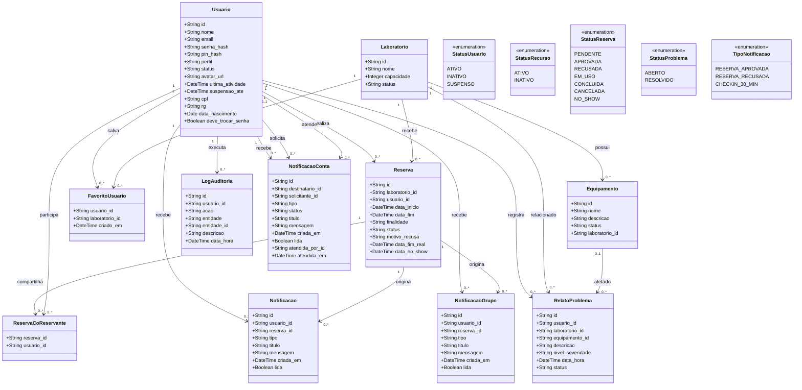

# Modelo de Domínio e Dados — Acessum

> Representação conferida com `backend/models.py`, `backend/schemas.py` e
> `backend/migrations.py`. IDs UUID são persistidos como texto de 36 caracteres no SQLite.
> `Aluno`, `Professor` e `Administrador` são valores do campo `usuarios.perfil`, não tabelas
> nem subclasses ORM.

## Dicionário de dados

As tabelas abaixo descrevem as colunas persistidas pelos modelos ORM. Uma coluna sem `nullable` explícito segue o padrão do SQLAlchemy (aceita `NULL`, exceto chaves primárias); os schemas da API podem exigir valores mesmo quando a coluna do banco permite `NULL`.

| Tabela / entidade | Campos e tipos principais | Chaves, nulabilidade e regras |
|---|---|---|
| `usuarios` (`Usuario`) | `id` texto(36), `nome` texto(100), `email` texto(100), `senha_hash` texto(255), `pin_hash` texto(255), `perfil` texto(20), `status` texto(20), `avatar_url` texto(500), `ultima_atividade` data/hora, `suspensao_ate` data/hora, `cpf` texto(11), `rg` texto(30), `data_nascimento` data, `deve_trocar_senha` booleano | PK `id`; e-mail único; índice único parcial para CPF não nulo. `pin_hash` é anulável e armazena exclusivamente o hash bcrypt do PIN pessoal de seis dígitos; contas legadas sem PIN permanecem `NULL`. Os campos de avatar, atividade, suspensão e documentos também são opcionais no banco. `status`: `ATIVO`, `INATIVO` ou `SUSPENSO`; `perfil`: `ALUNO`, `PROFESSOR` ou `ADMINISTRADOR`. |
| `laboratorios` (`Laboratorio`) | `id` texto(36), `nome` texto(100), `capacidade` inteiro, `status` texto(20) | PK `id`; nome obrigatório, único e indexado; capacidade obrigatória. Status utilizado: `ATIVO` ou `INATIVO`. |
| `equipamentos` (`Equipamento`) | `id` texto(36), `nome` texto(100), `descricao` texto(500), `status` texto(20), `laboratorio_id` texto(36) | PK `id`; FK obrigatória para `laboratorios`; nome indexado. Status utilizado: `ATIVO` ou `INATIVO`; não há quantidade, estado de manutenção nem reserva independente. |
| `reservas` (`Reserva`) | `id` texto(36), `laboratorio_id` texto(36), `usuario_id` texto(36), `data_inicio` e `data_fim` data/hora, `finalidade` texto(500), `status` texto(20), `motivo_recusa` texto(500), `data_fim_real` e `data_no_show` data/hora | PK `id`; FKs para laboratório e titular; `data_fim > data_inicio`; status limitado a `PENDENTE`, `APROVADA`, `RECUSADA`, `EM_USO`, `CONCLUIDA`, `CANCELADA` ou `NO_SHOW`. `motivo_recusa`, `data_fim_real` e `data_no_show` são opcionais. |
| `favoritos_usuarios` (`FavoritoUsuario`) | `usuario_id` texto(36), `laboratorio_id` texto(36), `criado_em` data/hora | PK composta (`usuario_id`, `laboratorio_id`); FKs com exclusão em cascata; índice por usuário. |
| `reserva_co_reservantes` (`ReservaCoReservante`) | `reserva_id` texto(36), `usuario_id` texto(36) | PK composta; FKs para reserva e usuário com exclusão em cascata; índice por usuário. Não transfere a titularidade da reserva. |
| `relatos_problemas` (`RelatoProblema`) | `id`, `usuario_id`, `laboratorio_id`, `equipamento_id`, `descricao` texto(2000), `nivel_severidade` texto(10), `status` texto(20), `data_hora` data/hora | PK `id`; FK para usuário; exatamente um entre `laboratorio_id` e `equipamento_id` deve ser preenchido. Severidade: `BAIXA`, `MEDIA` ou `ALTA`; status: `ABERTO` ou `RESOLVIDO`. |
| `notificacoes` (`Notificacao`) | `id`, `usuario_id`, `reserva_id`, `tipo` texto(30), `titulo` texto(120), `mensagem` texto(500), `criada_em` data/hora, `lida` booleano | FKs para usuário e reserva; unicidade (`reserva_id`, `tipo`); índice por usuário, leitura e criação. Tipos: `RESERVA_APROVADA`, `RESERVA_RECUSADA`, `CHECKIN_30_MIN`. |
| `notificacoes_grupo` (`NotificacaoGrupo`) | Mesma estrutura de `notificacoes` | Unicidade (`reserva_id`, `usuario_id`, `tipo`); usada para avisos dos co-reservantes. |
| `logs_auditoria` (`LogAuditoria`) | `id`, `usuario_id`, `acao` texto(50), `entidade` texto(30), `entidade_id` texto(36), `descricao` texto(500), `data_hora` data/hora | FK do ator para `usuarios`; índices por data/ação e usuário. A aplicação insere registros; não há edição/exclusão pela API. |
| `notificacoes_conta` (`NotificacaoConta`) | `id`, `destinatario_id`, `solicitante_id`, `tipo` texto(40), `titulo` texto(120), `mensagem` texto(500), `criada_em`, `lida`, `status` texto(20), `atendida_por_id`, `atendida_em` | FKs para usuários; tipo restrito a `RESET_SENHA_SOLICITADO`; status `PENDENTE` ou `ATENDIDA`; índice de solicitações pendentes deduplicadas por destinatário/solicitante. |

## Regras de integridade e acesso

- **Migrações aditivas:** `aplicar_migracoes(engine)` verifica colunas existentes antes de adicionar campos e usa `CREATE TABLE/INDEX IF NOT EXISTS` para as novas estruturas. O `main.py` executa as migrações e, em seguida, `Base.metadata.create_all`; reaplicar a inicialização não deve recriar tabelas existentes nem apagar dados.
- **Janela de suspensão:** três `NO_SHOW` do titular registrados nos 30 dias móveis levam a sete dias de suspensão. A data usada na janela é `reservas.data_no_show`; co-reservantes não recebem a penalidade. O estado é reavaliado quando a suspensão expira e antes de novas reservas.
- **Escopo de acesso:** o modelo não possui `tenant_id`, organização ou fronteira de inquilino. Portanto, não representa isolamento multi-tenant. A API filtra o histórico por titular/co-reservante e restringe os relatórios pessoais ao usuário autenticado; o Administrador consulta relatórios globais. O Professor acessa a fila de solicitações pendentes definida pela API.